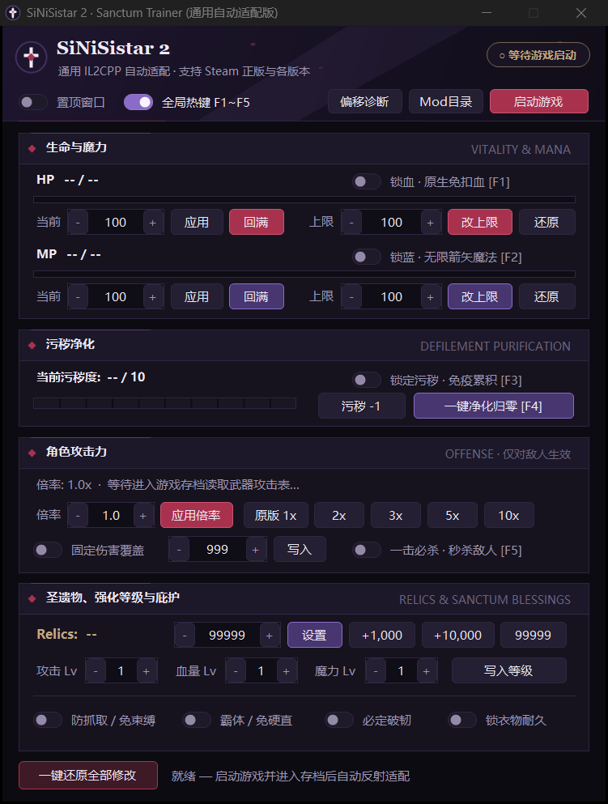

# SiNiSistar 2 · Sanctum Trainer (通用自动适配修改器)

> 面向《**SiNiSistar 2**》的原生 Windows 64 位独立修改器（零外部依赖、单文件免安装、**IL2CPP 运行时反射自动适配**）。



## ✨ 核心特性

- **通用免更新自动适配（Zero-Offset IL2CPP Reflection）**
  - 不依赖易失效的固定版本校验或写死字段偏移，自动解析目标 `GameAssembly.dll` 的 PE 导出表并扫描 `.data` 段定位 `ManagerList`，在运行时按 **C# 字段名**动态反射解析全部 30+ 项字段偏移。
  - 同时兼容 **Steam 正版 v1.3.1**、**老版本 v1.1.0** 以及后续游戏小版本更新，并提供内置「**偏移诊断**」窗口实时查看自动适配结果。
- **全部基于游戏引擎原生机制，极度稳定**
  - **生命与魔力（HP / MP）**：实时血蓝显示；引擎原生 **锁血 `[F1]`** / **锁蓝（无限箭矢/魔法）`[F2]`**（`BattleMainParameter.DontSub`）；自定义当前值、一键回满、**自定义血量/魔力上限**（同步写入 `EnhanceParameter` 成长表，切图自动保活，支持一键还原）。
  - **污秽净化（Defilement）**：实时显示当前污秽度 `0~10`；原生 **锁定污秽 `[F3]`**（`Debugger.IsNotIncrementalDefilement`）；**污秽 -1** 与 **一键净化归零 `[F4]`**（触发游戏主线程 `AbnormalData.Update()` 原生降级/清除，UI、立绘与挣脱系数同步刷新）。
  - **角色攻击力调整（仅对敌人生效，不误伤玩家）**：
    - **倍率缩放**：实时无损备份并按倍率缩放全部武器/魔法的 `EnhanceAttack.m_PowerArray` 伤害表，随时还原 `1.0x`；
    - **固定伤害覆盖** & **一击必杀 `[F5]`**（官方原生 `Debugger` 伤害判定，仅限 `DamageTargetType.Enemy`）。
  - **圣遗物（Relics）与强化等级**：实时读写 Relics（原生 `NextAdditiveRelics` 触发 HUD 即时刷新）及 `攻击Lv / 血量Lv / 魔力Lv`。
  - **圣堂庇护原生开关**：防抓取/免束缚、霸体/免硬直、必定破韧、锁衣物耐久。
- **零依赖 & 高分屏自适应**
  - 纯 C# WinForms 编写，无需安装 Python 或 Cheat Engine，Windows 10 / 11 自带 `.NET Framework 4.x` 即可双击运行。
  - 完整支持 100%~200% DPI 缩放、置顶窗口、全局热键开关、自动从游戏进程或 Steam 注册表定位 `Mod\Player` 目录。

---

## ⌨️ 默认全局热键

| 快捷键 | 功能 |
| :---: | :--- |
| `F1` | 开关 **锁血（原生免扣血）** |
| `F2` | 开关 **锁蓝（无限箭矢 / 魔法）** |
| `F3` | 开关 **锁定污秽（免疫新增污秽）** |
| `F4` | **一键净化污秽归零** |
| `F5` | 开关 **一击必杀（仅对敌人）** |

> 可随时在顶部横幅关闭「全局热键」防止误触。

---

## 🛠️ 自行编译（零依赖，仅需 Windows 自带组件）

无需安装 Visual Studio 或任何第三方库，Windows 10 / 11 系统自带 64 位 `.NET Framework 4.x` 编译器：

```bat
git clone https://github.com/Tookiiiii/SiNiSistar2-Trainer
cd SiNiSistar2-Trainer
build.bat
```

编译完成后会在 `release\SiNiSistar2_Trainer.exe` 生成单个免安装可执行文件。

---

## ⚠️ 常见问题与说明

1. **杀毒软件 / Windows Defender 误报**
   - 本程序需要调用 Windows API（`OpenProcess` / `ReadProcessMemory` / `WriteProcessMemory`）读写游戏进程内存，且未购买商业代码签名，因此可能触发杀毒软件启发式误报。
   - 本项目全部核心代码仅在单个源码文件 [src/SiNiSistar2Trainer.cs](src/SiNiSistar2Trainer.cs) 中，公开透明，不联网、不注入 DLL、不修改游戏磁盘文件。如有顾虑可直接审阅源码并运行 `build.bat` 自行编译。
2. **提示「权限不足」无法连接游戏**
   - 若游戏本身以管理员权限运行，请右键 `SiNiSistar2_Trainer.exe` 选择「以管理员身份运行」。
3. **本工具仅供单机游戏学习研究与个人娱乐使用**，请支持官方正版游戏。

---
